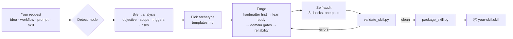

<div align="center">

# ⚒️ SKILL FORGE ULTRA

### Stop writing prompts. Start forging skills.

**The Claude Skill that builds Claude Skills.**<br>
Paste any idea, workflow, or 3-page prompt → get a lean, trigger-ready, validated `SKILL.md` you can install in seconds.


[**⚡ Install in 60s**](#-install-in-60-seconds) · [**🎬 See it work**](#-see-it-work) · [**🧠 How it works**](#-how-it-works) · [**🇮🇩 Bahasa Indonesia**](README.id.md)

</div>

---

## 😩 The problem

You wrote an epic prompt. *"You are an elite, world-class, 10x expert…"* Three pages long. It works… sometimes.

Then you turn it into a skill and:

- 🔇 **It never triggers** — no real `description`, so Claude doesn't know when to use it.
- 🫠 **Output is generic** — "be professional" isn't a standard anyone can meet.
- 🐘 **It's bloated** — the same rule four times, identity hype, filler.
- 🎲 **It hallucinates** — nothing tells it to separate facts from guesses.
- 💥 **It breaks** — references files that don't exist.

## 🔥 The fix

**Skill Forge Ultra** is an elite skill architect packed into one installable skill. It doesn't just rewrite your prompt — it **engineers an operating system for a class of problems**, then **validates and packages** it.

```text
You:     "turn this prompt into a skill" + <wall of text>
Forge:   ✅ skill-name/SKILL.md      trigger-rich, measurable, lean
         ✅ references/ + scripts/   only if they earn their place
         ✅ validated                 0 errors
         ✅ skill-name.skill          ready to install
```

---

## ✨ What makes it ULTRA

| | Feature | Why it matters |
|---|---|---|
| 🎯 | **Trigger-first engineering** | Writes descriptions with real user phrasings — casual, technical, *and* in your language. Skills that actually activate. |
| 🧭 | **7 auto-detected modes** | CREATE · IMPROVE · DEBUG · OPTIMIZE · MERGE · AUDIT · EXTEND. You never pick one; it infers. |
| 📏 | **Adjectives → gates** | "Viral", "professional", "production-ready" become observable checks for your domain. |
| 🛡️ | **Anti-hallucination built in** | Every forged skill separates fact / assumption / recommendation and never fakes citations or results. |
| 🧱 | **5 archetype templates** | Generator · Transformer · Analyst · Workflow · Persona — the right skeleton, not one-size-fits-all. |
| 🌐 | **10 domain gate packs** | Code, PRDs, marketing, research, design, strategy, education, data, docs, legal/medical/finance. |
| 🪶 | **Progressive disclosure** | Core stays small; heavy knowledge lives in `references/` and loads only when needed. |
| 🔬 | **Real validator** | Frontmatter, trigger quality, size & token estimate, missing/orphan files, duplicate rules, leftover placeholders. |
| 📦 | **One-command packaging** | Builds an installable `.skill` — and refuses if the skill is invalid. |
| 🧪 | **Tested + CI** | Unit tests + a ready GitHub Actions workflow ([`ci/`](ci/README.md)). Zero dependencies. |

---

## ⚡ Install in 60 seconds

**1. Grab the skill** — download [`dist/skill-forge-ultra.skill`](dist/skill-forge-ultra.skill) (or build it yourself):

```bash
git clone https://github.com/verycoolapps/Skill-Forge-Ultra.git
cd Skill-Forge-Ultra
python skill-forge-ultra/scripts/package_skill.py skill-forge-ultra dist/
```

**2. Install it where you use Claude**

| Where | How |
|---|---|
| **Claude.ai / Claude app** | Upload the `.skill` file in your Skills settings (or open it from a chat and hit **Save skill**). |
| **Claude Code** | `cp -r skill-forge-ultra ~/.claude/skills/` (personal) or `.claude/skills/` (project). |
| **Claude API** | Upload the folder via the Skills API — see [docs.claude.com](https://docs.claude.com). |

**3. Use it.** Just talk normally:

```text
Turn this prompt into a skill: <paste>
```

---

## 🎬 See it work

### Before — a typical "prompt-skill"

```markdown
---
name: Marketing Genius
description: A helpful marketing assistant.
---
You are the world's best marketer. Be creative, viral, and professional.
Always write amazing copy. Make it viral. Be professional at all times.
```

### Forge says (AUDIT mode)

```text
Verdict: rebuild — it will rarely trigger and gives no standard to meet.
- [critical] name not kebab-case → "marketing-copywriter"
- [critical] description has no triggers or scope → rewrite with use-cases + phrasings
- [major]    "creative, viral, professional" unmeasurable → audience + 1 goal + CTA + length limit
- [major]    no output contract → define variants, structure, format
- [major]    no reliability rule → forbid fabricated stats/testimonials
- [minor]    "viral"/"professional" stated twice → define once
Token savings available: ~40%
```

### After — forged

See real forged skills in [`examples/`](examples/): a [PRD writer](examples/prd-writer/SKILL.md), a [senior code reviewer](examples/code-review-pro/SKILL.md), and an [Indonesian UMKM caption writer](examples/caption-umkm-id/SKILL.md). Every one passes the validator.

---

## 🧠 How it works



**Priority order baked in:** correctness → your real objective → output quality → reliability → speed → token efficiency. It never trades the first three for the last.

---

## 🧭 The 7 modes

| Mode | Say something like | You get |
|---|---|---|
| **CREATE** | "make a skill that turns meeting notes into Jira tickets" | A new skill, validated and packaged |
| **IMPROVE** | "make this skill way more powerful" | Upgraded skill, same `name`, + changelog |
| **DEBUG** | "my skill never triggers when I ask for invoices" | Cause → fix → how to verify, + patched file |
| **OPTIMIZE** | "this skill is too long" | Leaner skill + before/after size, no capability lost |
| **MERGE** | "combine these two skills" | One coherent skill — or advice to keep them apart |
| **AUDIT** | "review this SKILL.md" | Verdict + severity-ranked defects with fixes |
| **EXTEND** | "add CSV export to my report skill" | New capability isolated, old behavior intact |

---

## 🔬 The validator

```bash
python skill-forge-ultra/scripts/validate_skill.py path/to/skill          # human-readable
python skill-forge-ultra/scripts/validate_skill.py path/to/skill --json   # for CI / tooling
```

```text
OK: 'skill-forge-ultra' is valid — 113 body lines, ~2125 tokens, 660-char description, 6 file(s)
```

| Check | Level |
|---|---|
| YAML frontmatter present & parseable, only allowed keys | ERROR |
| `name` kebab-case, ≤ 64 chars | ERROR |
| `description` present, ≤ 1024 chars, no `<` `>` | ERROR |
| Every referenced `references/` · `scripts/` · `assets/` file exists | ERROR |
| Body ≤ 500 lines, exactly one `SKILL.md` | ERROR |
| Description long enough & has a "use when" trigger clause | WARN |
| Name matches folder, body ≤ 300 lines | WARN |
| Orphan files, duplicated rules, `TODO` / `{placeholders}` | WARN |

Use it on **any** skill, not just forged ones.

---

## 📁 Repo map

```
Skill-Forge-Ultra/
├── skill-forge-ultra/              ← the skill (install this folder)
│   ├── SKILL.md                    core: modes, forging rules, self-audit, delivery
│   ├── references/
│   │   ├── modes-playbook.md       step-by-step for all 7 modes + prompt→skill
│   │   ├── templates.md            5 archetype templates + script stub
│   │   └── quality-gates.md        10 domain gate packs, description formula, defect table
│   └── scripts/
│       ├── validate_skill.py       the validator
│       └── package_skill.py        validate → build .skill
├── examples/                       forged example skills + audit demo
├── tests/                          unit tests
├── dist/skill-forge-ultra.skill    prebuilt, ready to install
└── ci/validate.yml                 GitHub Actions workflow (see ci/README.md to enable)
```

---

## ❓ FAQ

**Is it just a long prompt?** No. It's a skill with on-demand references, templates, and executable scripts that verify and package what it builds.

**Will forged skills be shorter than my prompt?** Usually, because ceremony and repetition get cut — but correctness and capability come first. The validator reports the real size so you can see.

**Does it work in Bahasa Indonesia?** Yes. It replies in your language and adds your-language trigger phrases to every skill it forges. 🇮🇩 [Baca versi Indonesia →](README.id.md)

**Does it guarantee perfect skills?** No tool can. It guarantees structural validity and pushes hard on quality; test your skill on real prompts.

**Dependencies?** None. Python 3.8+ stdlib. Uses PyYAML only if it's already installed.

---

## 🤝 Contributing

New domain gates, templates, and example skills are very welcome. See [CONTRIBUTING.md](CONTRIBUTING.md).

## ⭐ If this saved you an afternoon of prompt-fiddling, star the repo.

[](https://star-history.com/#verycoolapps/Skill-Forge-Ultra&Date)

<div align="center">

**MAXIMUM PRACTICAL QUALITY · MINIMUM NECESSARY COMPLEXITY · MAXIMUM TOKEN EFFICIENCY**

MIT © verycoolapps

</div>
